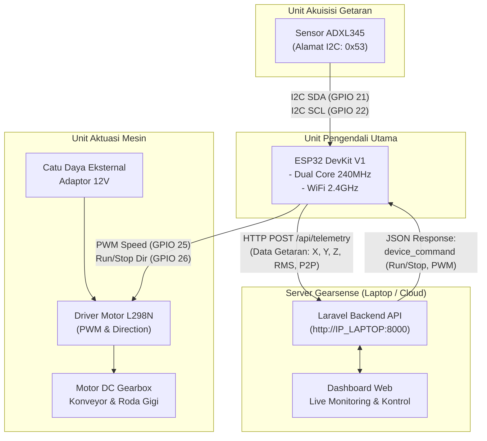

# Panduan Perangkat Keras IoT & Firmware ESP32 Gearsense
**Sistem Deteksi Kerusakan Roda Gigi Konveyor Berbasis AI & IoT**  
*Program Studi Teknik Informatika, Fakultas Teknologi Informasi, Universitas YARSI*

---

## 1. Daftar Komponen Kebutuhan (Bill of Materials)

| No | Komponen | Spesifikasi / Model | Fungsi Utama |
|---|---|---|---|
| 1 | **Mikrokontroler** | ESP32 DevKit V1 (30 atau 38 pin) | Mengambil sinyal getaran, ekstraksi fitur statistik, dan komunikasi WiFi ke server web |
| 2 | **Sensor Getaran** | ADXL345 Digital Accelerometer (I2C) | Membaca getaran tri-axial ($X, Y, Z$) hingga $\pm 16\text{ g}$ |
| 3 | **Driver Motor** | Modul L298N / MOSFET IRF520 / Relay 5V | Mengatur saklar putar dan kecepatan (PWM) motor DC konveyor |
| 4 | **Motor Penggerak** | Motor DC Gearbox 12V / 24V | Penggerak transmisi sabuk konveyor dan roda gigi uji |
| 5 | **Catu Daya** | Adaptor 12V (untuk motor) & Micro-USB 5V (ESP32) | Sumber tegangan operasional perangkat keras |
| 6 | **Kabel & Breadboard**| Jumper Wire (Male-to-Female, Male-to-Male) | Penghubung sirkuit antar modul |

---

## 2. Skema Pengkabelan & Pinout Lengkap

### A. Pengkabelan Sensor ADXL345 ke ESP32 (Komunikasi I2C)

> [!IMPORTANT]
> Pin **CS** pada ADXL345 wajib dihubungkan ke **3.3V** agar sensor beroperasi dalam mode **I2C** (bukan SPI).  
> Pin **SDO** dihubungkan ke **GND** agar alamat I2C terkunci pada `0x53`.

| Pin ADXL345 | Pin ESP32 DevKit | Keterangan |
|---|---|---|
| **VCC** | **3V3** | Tegangan logika sensor 3.3V (stabil) |
| **GND** | **GND** | Ground bersama (*common ground*) |
| **CS** | **3V3** | Memilih protokol I2C bus |
| **SDO** | **GND** | Menentukan alamat I2C ke `0x53` |
| **SDA** | **GPIO 21** | Jalur data I2C (*I2C Data Bus*) |
| **SCL** | **GPIO 22** | Jalur clock I2C (*I2C Clock Bus*) |

---

### B. Pengkabelan Driver Motor L298N ke ESP32 & Motor DC

| Pin Modul L298N | Terhubung Ke | Keterangan |
|---|---|---|
| **ENA (Jumper dicabut)**| **GPIO 25 (ESP32)** | Sinyal PWM kecepatan motor (0 - 255) |
| **IN1** | **GPIO 26 (ESP32)** | Kontrol arah putar / saklar ON-OFF motor |
| **IN2** | **GND (ESP32)** | Polaritas arah putar konveyor |
| **GND L298N** | **GND (ESP32) & GND Adaptor 12V** | **Wajib Common Ground** antar catu daya |
| **+12V Power** | **Kutub (+) Adaptor 12V** | Sumber daya motor konveyor |
| **OUT1 & OUT2** | **Terminal Motor DC** | Output daya ke motor penggerak konveyor |

---

## 3. Diagram Arsitektur Sirkuit



---

## 4. Panduan Menjalankan Firmware di Arduino IDE

### Langkah 1: Instalasi Board ESP32 di Arduino IDE
1. Buka Arduino IDE $\rightarrow$ **File** $\rightarrow$ **Preferences**.
2. Pada kolom *Additional Boards Manager URLs*, tempelkan URL:
   ```
   https://raw.githubusercontent.com/espressif/arduino-esp32/gh-pages/package_esp32_index.json
   ```
3. Buka **Tools** $\rightarrow$ **Board** $\rightarrow$ **Boards Manager**, cari `esp32` oleh *Espressif Systems*, lalu klik **Install**.

### Langkah 2: Instalasi Pustaka (Libraries) yang Diperlukan
Buka **Sketch** $\rightarrow$ **Include Library** $\rightarrow$ **Manage Libraries...**, lalu cari dan instal:
1. **`Adafruit ADXL345`** (oleh Adafruit)
2. **`Adafruit Unified Sensor`** (oleh Adafruit)
3. **`ArduinoJson`** (oleh Benoit Blanchon - versi 6 atau 7)

### Langkah 3: Konfigurasi Parameter WiFi & IP Server
Buka file `gearsense_firmware.ino`, lalu sesuaikan baris 24-31:
```cpp
const char* WIFI_SSID     = "NAMA_WIFI_HOTSPOT_ANDA";
const char* WIFI_PASSWORD = "PASSWORD_WIFI_ANDA";

// Cek IP Laptop Anda di Terminal Windows dengan perintah 'ipconfig'
const char* SERVER_BASE_URL = "http://192.168.1.100:8000"; 
```

### Langkah 4: Upload Firmware ke ESP32
1. Hubungkan ESP32 ke port USB laptop menggunakan kabel data Micro-USB.
2. Di Arduino IDE, pilih board: **Tools** $\rightarrow$ **Board** $\rightarrow$ **ESP32 Arduino** $\rightarrow$ **DOIT ESP32 DEVKIT V1**.
3. Pilih port COM yang terdeteksi di **Tools** $\rightarrow$ **Port** (misal `COM3` / `COM4`).
4. Klik tombol **Upload** (tanda panah kanan).
5. Buka **Tools** $\rightarrow$ **Serial Monitor** pada kecepatan baud **115200**.

---

## 5. Cara Uji Coba Hardware Awal (Tanpa Mesin Konveyor)

Anda **TIDAK PERLU** menunggu mesin konveyor tiba untuk membuktikan hardware berfungsi:
1. Rangkai hanya **ESP32 + ADXL345** di atas breadboard (cukup 4 kabel: 3.3V, GND, SDA pin 21, SCL pin 22).
2. Nyalakan server Laravel di laptop:
   ```powershell
   php artisan serve --host=0.0.0.0 --port=8000
   ```
   *(Catatan: flag `--host=0.0.0.0` wajib agar server bisa diakses oleh ESP32 dari jaringan WiFi lokal).*
3. Pasang daya ESP32 $\rightarrow$ Perhatikan di Serial Monitor hingga muncul tulisan:
   ```text
   [WiFi] Terhubung!
   [ADXL345] BERHASIL TERHUBUNG!
   [HTTP 201 OK] Z_RMS: 0.852 g | P2P_Z: 0.124 g | Kondisi: NORMAL
   ```
4. Buka browser di laptop ke halaman **Live Monitoring**:
   * Goyangkan sensor ADXL345 perlahan dengan tangan $\rightarrow$ Nilai getaran akan naik sebanding dengan getaran tangan Anda.
   * Ketukkan sensor perlahan ke meja $\rightarrow$ Sumbu Z akan mendeteksi lonjakan impak (*shock pulse*) dan status di web akan berubah menjadi deteksi anomali.
